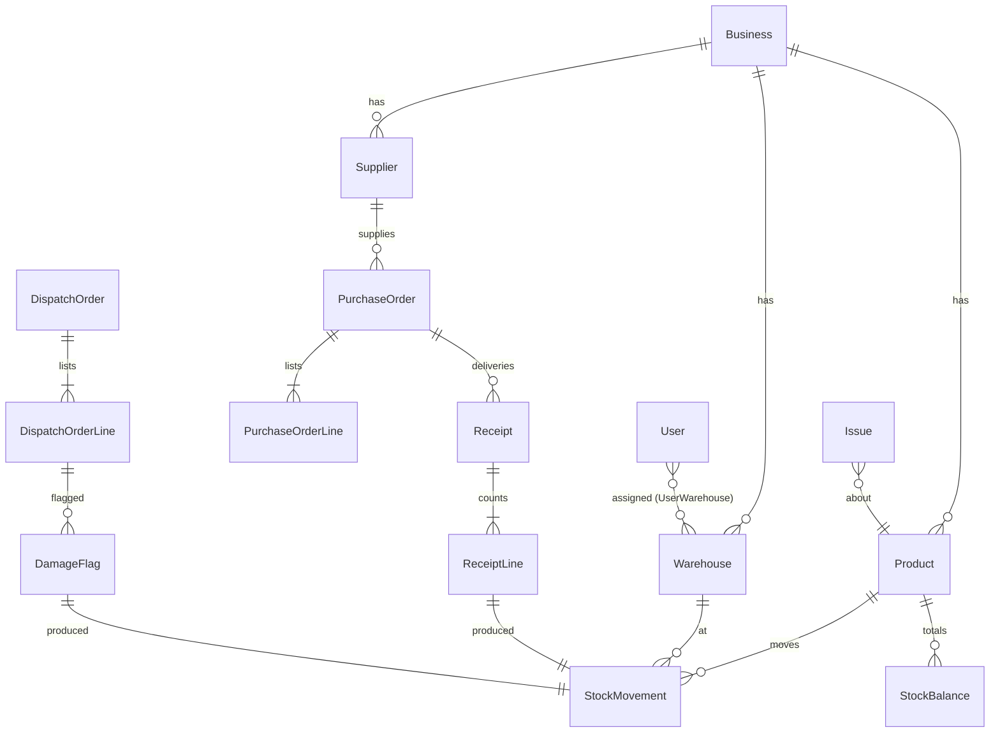

# Entities — backend

Entities added by the backend unit (U2 in `unit-of-work.md`), from the component catalogue in `components.md`, the table ownership in `contract-summary.md` (C5), the requirements FR2–FR17 in `requirements.md` and this stage's answers Q1–Q7. Business, User and Session already exist from the walking skeleton (`construction/walking-skeleton/functional-design/entities.md`). Every entity below carries `businessId`, and every query filters by it (BR3.1).

Quantities are whole numbers of base units (pieces). Money is a decimal with 4 places, per base unit.

```yaml
entities:
  # ---- IdentityAccess (adds to U1) ----
  - name: Warehouse
    owner: IdentityAccess
    description: A place where stock is kept; at most 3 active per business
    attributes:
      - { name: id, type: identifier, required: true, unique: true }
      - { name: businessId, type: identifier, required: true, references: Business.id }
      - { name: name, type: text, required: true, min: 1, max: 60, constraints: [trimmed, unique among the business's active warehouses ignoring case] }
      - { name: active, type: boolean, required: true, default: true }
      - { name: createdAt, type: timestamp, required: true, default: now }
  - name: UserWarehouse
    owner: IdentityAccess
    description: A warehouse assigned to a Supervisor, Warehouse worker or Sales rep
    attributes:
      - { name: userId, type: identifier, required: true, references: User.id }
      - { name: warehouseId, type: identifier, required: true, references: Warehouse.id }
    constraints: [one row per user and warehouse; Owners, Managers and Accountants have no rows and cover all warehouses]

  # ---- Catalogue ----
  - name: Product
    owner: Catalogue
    attributes:
      - { name: id, type: identifier, required: true, unique: true }
      - { name: businessId, type: identifier, required: true }
      - { name: name, type: text, required: true, min: 1, max: 100 }
      - { name: sku, type: text, required: true, min: 1, max: 40, constraints: [unique in the business ignoring case] }
      - { name: category, type: text, required: true, min: 1, max: 60 }
      - { name: baseUnitName, type: text, required: true, min: 1, max: 20, examples: [pcs, bag] }
      - { name: packUnitName, type: text, required: false, max: 20, examples: [ctn] }
      - { name: packSize, type: integer, required: false, constraints: [2 or more; present exactly when packUnitName is present] }
      - { name: baseBarcode, type: text, required: false, max: 40 }
      - { name: packBarcode, type: text, required: false, max: 40 }
      - { name: createdAt, type: timestamp, required: true }
    constraints: [a barcode value appears at most once across all base and pack barcodes of the business]
  - name: Supplier
    owner: Catalogue
    attributes:
      - { name: id, type: identifier, required: true, unique: true }
      - { name: businessId, type: identifier, required: true }
      - { name: name, type: text, required: true, min: 1, max: 100 }
      - { name: contactPerson, type: text, required: false, max: 100 }
      - { name: phone, type: text, required: false, max: 20 }
      - { name: address, type: text, required: false, max: 200 }
      - { name: archived, type: boolean, required: true, default: false }

  # ---- StockLedger ----
  - name: StockMovement
    owner: StockLedger
    description: One permanent change of stock; inserted, never updated or deleted
    attributes:
      - { name: id, type: identifier, required: true, unique: true }
      - { name: businessId, type: identifier, required: true }
      - { name: productId, type: identifier, required: true, references: Product.id }
      - { name: warehouseId, type: identifier, required: true, references: Warehouse.id }
      - { name: fromState, type: enum, required: true, allowed: [external, available, reserved, damaged] }
      - { name: toState, type: enum, required: true, allowed: [external, available, reserved, damaged], constraints: [differs from fromState] }
      - { name: quantityBase, type: integer, required: true, constraints: [greater than 0] }
      - { name: unitCost, type: decimal(14,4), required: true, constraints: [0 or more] }
      - { name: reason, type: enum, required: true, allowed: [opening_balance, received, reserved, released, dispatched, damaged, expired, other] }
      - { name: userId, type: identifier, required: true, references: User.id }
      - { name: serverTime, type: timestamp, required: true, default: now }
      - { name: sourceType, type: enum, required: true, allowed: [opening_stock, purchase_order, dispatch_order, damage_flag] }
      - { name: sourceId, type: identifier, required: true }
  - name: StockBalance
    owner: StockLedger
    description: Running total per product, warehouse and state; always equals the sum of movements
    attributes:
      - { name: businessId, type: identifier, required: true }
      - { name: productId, type: identifier, required: true }
      - { name: warehouseId, type: identifier, required: true }
      - { name: state, type: enum, required: true, allowed: [available, reserved, damaged] }
      - { name: quantityBase, type: integer, required: true, constraints: [0 or more, enforced by a database check] }
    constraints: [one row per business, product, warehouse and state]
  - name: StockCost
    owner: StockLedger
    description: Latest known unit cost per product and warehouse (Q6); added to the StockLedger entities listed in components.md
    attributes:
      - { name: businessId, type: identifier, required: true }
      - { name: productId, type: identifier, required: true }
      - { name: warehouseId, type: identifier, required: true }
      - { name: unitCost, type: decimal(14,4), required: true }
      - { name: updatedAt, type: timestamp, required: true }
  - name: IdempotencyRecord
    owner: StockLedger
    description: One processed user action (Idempotency-Key) and its stored response; this is the "ProcessedAction" of components.md under its final name
    attributes:
      - { name: businessId, type: identifier, required: true }
      - { name: userId, type: identifier, required: true }
      - { name: key, type: uuid, required: true, constraints: [unique with businessId and userId] }
      - { name: endpoint, type: text, required: true, examples: ["POST /receiving/{id}/lines"] }
      - { name: requestHash, type: text, required: true, constraints: [sha256 of method, route, path parameters and canonical body] }
      - { name: responseStatus, type: integer, required: false, description: empty while the request's transaction is still running; set before commit }
      - { name: responseBody, type: json, required: false, description: as responseStatus }
      - { name: createdAt, type: timestamp, required: true }

  # ---- Purchasing ----
  - name: PurchaseOrder
    owner: Purchasing
    attributes:
      - { name: id, type: identifier, required: true, unique: true }
      - { name: businessId, type: identifier, required: true }
      - { name: number, type: text, required: true, constraints: ["PO-<n>, n counts up per business from 1"] }
      - { name: supplierId, type: identifier, required: true, references: Supplier.id }
      - { name: warehouseId, type: identifier, required: true, references: Warehouse.id }
      - { name: expectedDate, type: date, required: true }
      - { name: status, type: enum, required: true, allowed: [draft, sent, partly_received, received, cancelled], default: draft }
      - { name: closedShort, type: boolean, required: true, default: false }
      - { name: createdBy, type: identifier, required: true, references: User.id }
      - { name: createdAt, type: timestamp, required: true }
      - { name: finishedAt, type: timestamp, required: false, description: when it became received or cancelled }
  - name: PurchaseOrderLine
    owner: Purchasing
    attributes:
      - { name: id, type: identifier, required: true, unique: true }
      - { name: purchaseOrderId, type: identifier, required: true }
      - { name: productId, type: identifier, required: true, constraints: [unique within the order] }
      - { name: orderedQtyBase, type: integer, required: true, constraints: [greater than 0] }
      - { name: unitCostBase, type: decimal(14,4), required: true, constraints: [0 or more] }
      - { name: receivedQtyBase, type: integer, required: true, default: 0, description: total over completed and open deliveries }
      - { name: shortfallRaisedBase, type: integer, required: true, default: 0 }
      - { name: overRaisedBase, type: integer, required: true, default: 0 }
  - name: Receipt
    owner: Purchasing
    description: One delivery being counted against a purchase order; at most one open per order
    attributes:
      - { name: id, type: identifier, required: true, unique: true }
      - { name: purchaseOrderId, type: identifier, required: true }
      - { name: startedBy, type: identifier, required: true }
      - { name: startedAt, type: timestamp, required: true }
      - { name: completedBy, type: identifier, required: false }
      - { name: completedAt, type: timestamp, required: false }
  - name: ReceiptLine
    owner: Purchasing
    attributes:
      - { name: id, type: identifier, required: true, unique: true }
      - { name: receiptId, type: identifier, required: true }
      - { name: productId, type: identifier, required: true, constraints: [unique within the receipt] }
      - { name: countedQtyBase, type: integer, required: true, constraints: [greater than 0] }
      - { name: movementId, type: identifier, required: true, references: StockMovement.id }
      - { name: savedBy, type: identifier, required: true }
      - { name: savedAt, type: timestamp, required: true }
  - name: PurchaseOrderCounter
    owner: Purchasing
    attributes: [{ name: businessId, type: identifier, required: true, unique: true }, { name: lastNumber, type: integer, required: true }]

  # ---- Dispatch ----
  - name: DispatchOrder
    owner: Dispatch
    attributes:
      - { name: id, type: identifier, required: true, unique: true }
      - { name: businessId, type: identifier, required: true }
      - { name: number, type: text, required: true, constraints: ["DO-<n>, n counts up per business from 1"] }
      - { name: customerName, type: text, required: true, min: 1, max: 100 }
      - { name: warehouseId, type: identifier, required: true }
      - { name: neededBy, type: date, required: true }
      - { name: status, type: enum, required: true, allowed: [open, part_dispatched, dispatched, cancelled], default: open }
      - { name: pickedSinceConfirm, type: boolean, required: true, default: false }
      - { name: createdBy, type: identifier, required: true }
      - { name: createdAt, type: timestamp, required: true }
      - { name: finishedAt, type: timestamp, required: false }
  - name: DispatchOrderLine
    owner: Dispatch
    attributes:
      - { name: id, type: identifier, required: true, unique: true }
      - { name: dispatchOrderId, type: identifier, required: true }
      - { name: productId, type: identifier, required: true, constraints: [unique within the order] }
      - { name: orderedQtyBase, type: integer, required: true, constraints: [greater than 0] }
      - { name: reservedQtyBase, type: integer, required: true, constraints: [0 or more] }
      - { name: pickedQtyBase, type: integer, required: true, default: 0 }
      - { name: shortQtyBase, type: integer, required: true, default: 0 }
      - { name: damagedQtyBase, type: integer, required: true, default: 0 }
      - { name: cancelledQtyBase, type: integer, required: true, default: 0, description: quantity released by cancelling the order }
    constraints: [reservedQtyBase + pickedQtyBase + shortQtyBase + cancelledQtyBase = orderedQtyBase, checked by the database; all four are 0 or more]
  - name: DispatchOrderCounter
    owner: Dispatch
    attributes: [{ name: businessId, type: identifier, required: true, unique: true }, { name: lastNumber, type: integer, required: true }]

  # ---- Damage ----
  - name: DamageFlag
    owner: Damage
    attributes:
      - { name: id, type: identifier, required: true, unique: true }
      - { name: businessId, type: identifier, required: true }
      - { name: productId, type: identifier, required: true }
      - { name: warehouseId, type: identifier, required: true }
      - { name: dispatchOrderLineId, type: identifier, required: true }
      - { name: quantityBase, type: integer, required: true, constraints: [greater than 0] }
      - { name: reason, type: enum, required: true, allowed: [damaged, expired, other] }
      - { name: note, type: text, required: false, max: 500 }
      - { name: flaggedBy, type: identifier, required: true }
      - { name: flaggedAt, type: timestamp, required: true }
      - { name: movementId, type: identifier, required: true }

  # ---- Issues ----
  - name: Issue
    owner: Issues
    attributes:
      - { name: id, type: identifier, required: true, unique: true }
      - { name: businessId, type: identifier, required: true }
      - { name: type, type: enum, required: true, allowed: [shortfall, over_delivery, damage_flag, dispatch_short] }
      - { name: productId, type: identifier, required: true }
      - { name: warehouseId, type: identifier, required: true }
      - { name: quantityBase, type: integer, required: true, constraints: [greater than 0] }
      - { name: raisedBy, type: identifier, required: true }
      - { name: raisedAt, type: timestamp, required: true }
      - { name: sourceType, type: enum, required: true, allowed: [purchase_order, dispatch_order, damage_flag] }
      - { name: sourceId, type: identifier, required: true }
      - { name: status, type: enum, required: true, allowed: [open], default: open }
```

## Relationships



<!-- Text fallback: A Business has Warehouses, Products and Suppliers. Users are assigned to Warehouses through UserWarehouse. Products and Warehouses have Stock movements and Stock balances. A Supplier has Purchase orders; a Purchase order has lines and deliveries (Receipts); each Receipt line produced one Stock movement. A Dispatch order has lines; a line can have Damage flags; each Damage flag produced one Stock movement. Each Issue is about one Product. -->

## Summary

| Entity | Owner | Purpose |
|---|---|---|
| Warehouse, UserWarehouse | IdentityAccess | Places and who works where |
| Product, Supplier | Catalogue | What is stocked and who supplies it |
| StockMovement, StockBalance, StockCost, IdempotencyRecord | StockLedger | Permanent record, totals, latest cost, apply-once |
| PurchaseOrder, PurchaseOrderLine, Receipt, ReceiptLine, PurchaseOrderCounter | Purchasing | Buying and blind receiving |
| DispatchOrder, DispatchOrderLine, DispatchOrderCounter | Dispatch | Customer orders, reservation, picking |
| DamageFlag | Damage | Damaged stock found while picking |
| Issue | Issues | Items that need a decision later |

## Assumptions & Open Questions

None.
