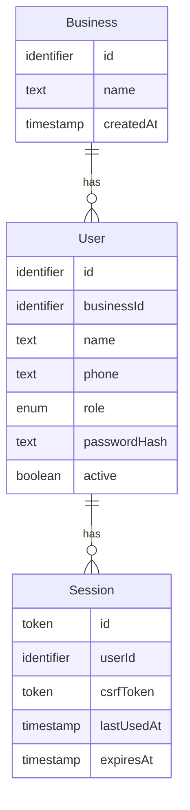

# Functional Specification — walking-skeleton

Behaviour of the walking skeleton (U1 in `unit-of-work.md`; US1.1 and US1.2 in `unit-of-work-story-map.md`), built from `requirements.md`, the IdentityAccess component in `components.md` and the `/auth/*` endpoints in `contract-summary.md`. Data shapes are in `entities.md`; decision logic in `rules.md`. This file is the source of truth for the workflows and the session lifecycle.

## Scope of This Unit's Checks

The skeleton proves sign-up, sign-in, sign-out, the Owner's landing page, password hashing and the theme switch. For business isolation it proves the foundation: the caller context always carries the business, and every data-access function requires it (BR3.1). The record-by-ID refusal in AC1.1.4 needs record endpoints, which arrive in the backend unit, so that check runs there. Other roles' landing pages, deactivated users and the full accessibility pass are also checked in the backend and frontend units, once those users and screens exist (Q2).

## Workflows

### WF1 Sign up a business (US1.1)

1. The person opens the Sign up page and enters business name, their name, phone number and password.
2. The web app sends `POST /api/v1/auth/signup`.
3. The backend validates the fields (BR1.1, BR1.2, BR1.4). On failure it returns the error with the field; the page keeps every typed value and shows the message under the field.
4. The backend checks the phone is not already used in any business (BR1.3). If it is, it returns 409 DUPLICATE for phone.
5. In one transaction it creates the Business and the Owner user with a hashed password (BR1.5, BR1.6). If the phone's uniqueness constraint fails here (a simultaneous sign-up), it returns 409 DUPLICATE for phone and saves nothing.
6. It creates a Session (see Session State Machine), sets the HttpOnly session cookie and returns **201** with the caller and the CSRF token.
7. The web app opens the Owner's home (Setup home placeholder) (BR4.1).

Error path: any other failure at step 5 saves nothing and returns 500 INTERNAL_ERROR; the page shows "Couldn't save. Try again." with values kept (BR2.8).

### WF2 Sign in (US1.2)

1. The person enters phone and password on the Sign in page; the web app sends `POST /api/v1/auth/signin`.
2. The backend normalizes the phone (BR1.2) and looks up the user across all businesses.
3. If a field is missing or empty, the phone is invalid, there is no user, or the password does not match, it returns 401 INVALID_CREDENTIALS "Sign-in details are not correct." (BR2.1).
4. If the password matches but the user is inactive, it returns 401 ACCOUNT_DEACTIVATED "This account is deactivated." (BR2.2).
5. Otherwise it creates a Session, sets the cookie and returns **200** with the caller and the CSRF token.
6. The web app opens the role's home (BR4.1).

### WF3 Sign out (US1.2)

1. The person selects Sign out; the web app sends `POST /api/v1/auth/signout` with the CSRF token (BR2.5).
2. The backend deletes the session and clears the cookie, and returns **204** (BR2.4).
3. The web app shows the Sign in page. Any later request with the old cookie gets 401 NOT_SIGNED_IN.

### WF4 Authenticate a request

1. Every request except sign-up and sign-in must carry the session cookie; without it the backend returns 401 NOT_SIGNED_IN.
2. The backend looks up the session the cookie names. If no session is stored (never existed, or signed out), it returns 401 NOT_SIGNED_IN (BR2.4).
3. If the stored session has expired, it deletes it and returns 401 SESSION_ENDED (BR2.3).
4. It loads the user. If the user is inactive, it deletes the session and returns 401 SESSION_ENDED (BR2.6).
5. For any non-GET request, it compares `X-CSRF-Token` with the session's token; a mismatch returns 403 FORBIDDEN (BR2.5).
6. It extends the session (lastUsedAt now, expiresAt now plus 12 hours) and runs the request with the caller context (see below). Every data-access function requires the caller's businessId (BR3.1).

### Caller Context (contract C2, owned by this unit)

| Field | Value in this unit |
|---|---|
| userId, businessId, businessName, name, role | From the signed-in user and their business |
| warehouseIds | Always an empty list; filled from warehouse assignment in the backend unit |

`authorize(caller, action, warehouseId)` exists from this unit with one rule: the caller is signed in and active. The backend unit adds the role table and warehouse scope to it, without changing its signature (BR2.7).

### WF5 Open the app

1. On load the web app applies the saved theme, or the device theme if none is saved (BR5.1).
2. It calls `GET /api/v1/auth/me`. On 200 it opens the role's home (or the page the person first asked for); on any 401 it shows Sign in with no message.

## Session State Machine

| Current state | Event | Guard | Next state | Actions |
|---|---|---|---|---|
| (none) | Sign-up or sign-in succeeds | — | Active | Create session, set cookie, expiresAt = now + 12 h |
| Active | Authenticated request | now ≤ expiresAt and user active | Active | Extend expiresAt to now + 12 h |
| Active | Authenticated request | now > expiresAt | Ended | Delete session; 401 SESSION_ENDED |
| Active | Authenticated request | user inactive | Ended | Delete session; 401 SESSION_ENDED |
| Active | Sign out | — | Ended | Delete session; clear cookie; 204 |
| Active | Not used for 7 days past expiresAt | — | Ended | Removed by the daily clean-up |

Ended is terminal and the session is no longer stored, so a later request with its cookie gets NOT_SIGNED_IN; a new sign-in creates a new session.

## Entity-Relationship View (derived from entities.md)

<!-- Text fallback: A Business has many Users. A User has many Sessions. Business holds id, name and createdAt. User holds id, businessId, name, phone, role, passwordHash and active. Session holds id, userId, csrfToken, lastUsedAt and expiresAt. -->

## Rules Summary (derived from rules.md)

| Group | Rules |
|---|---|
| Sign-up | BR1.1 required fields, BR1.2 phone format, BR1.3 phone unique, BR1.4 password length, BR1.5 hashing, BR1.6 all-or-nothing |
| Sign-in and sessions | BR2.1 generic failure, BR2.2 deactivated refused, BR2.3 12-hour expiry, BR2.4 sign-out, BR2.5 CSRF, BR2.6 active user, BR2.7 caller context, BR2.8 unexpected failures |
| Isolation | BR3.1 business scoping |
| Web app | BR4.1 role landing, BR5.1 theme, BR5.2 translation file |

## Error Catalogue

| Code | Status | When | Message shown |
|---|---|---|---|
| VALIDATION_FAILED | 400 | BR1.1, BR1.2, BR1.4 | Field-specific message under the field |
| DUPLICATE | 409 | BR1.3 | "This phone number is already registered" |
| NOT_SIGNED_IN | 401 | No cookie, or the cookie names no stored session (never existed or signed out) | Sign in page, no message |
| SESSION_ENDED | 401 | Stored session expired, or user inactive | Sign in page with "Your session ended. Sign in again." |
| INVALID_CREDENTIALS | 401 | BR2.1 | "Sign-in details are not correct." on the Sign in form |
| ACCOUNT_DEACTIVATED | 401 | BR2.2 | "This account is deactivated." on the Sign in form |
| FORBIDDEN | 403 | BR2.5 | "Couldn't save. Try again." |
| NOT_FOUND | 404 | BR3.1 | "Not found" |
| INTERNAL_ERROR | 500 | BR2.8 | "Couldn't save. Try again." |

INVALID_CREDENTIALS, ACCOUNT_DEACTIVATED and INTERNAL_ERROR are additive codes under contract v1.

## Assumptions & Open Questions

None.
