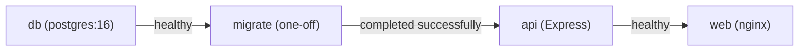

# Reliability Design — walking-skeleton

How U1 meets `nfr-requirements/reliability-requirements.md` (NFR8.4–NFR8.8, NFR1.16, NFR1.17). These are single-machine patterns: health-gated start order, transactions, a pool that survives outages, and graceful shutdown. Circuit breakers and retries are not used, because the only dependency is the local database and failing fast with INTERNAL_ERROR is the chosen behaviour (BR2.8).

## Start Order (NFR8.4, NFR8.5)



<!-- Text fallback: db must be healthy before migrate runs; migrate must finish successfully before api starts; api must be healthy before web starts. -->

- **`db`:** health check `["CMD-SHELL", "pg_isready -h 127.0.0.1 -U $${POSTGRES_USER} -d $${POSTGRES_DB}"]` every 2 s, with 30 retries and `start_period: 10s`.
  - `-h 127.0.0.1` forces a TCP check. During first-time setup the official image listens only on the unix socket, so a socket check could pass too early.
  - `$$` stops Compose from expanding the variable itself.
  - Data is kept in the named volume `pgdata`.
- **`migrate`:** runs `node dist/migrate.js` with `restart: "no"`, then exits 0.
  - It uses Kysely's `Migrator` with a small custom `SqlFileMigrationProvider`, because Kysely has no plain-SQL provider. The provider reads `migrations/*.sql` in name order and runs each file with `sql.raw` inside the migration.
  - The Dockerfile copies `apps/api/migrations/` into the image next to `dist/`.
  - The migrations are forward-only, and Kysely's migration lock wraps them.
  - If a migration fails, the stack stops with the migration error and `api` does not start.
- **Compose version:** `service_completed_successfully` and `docker compose up --wait` need Docker Compose v2.24 or later. Docker Desktop 4.x includes it, and `npm run verify` checks `docker compose version` first.
- **`api`:** `depends_on: { db: service_healthy, migrate: service_completed_successfully }`. Its health check is `GET /api/v1/health` (NFR8.13). It uses `restart: unless-stopped`.
- **`web`:** `depends_on: { api: service_healthy }`. `npm run verify` uses `docker compose up --wait` with a 60 s timeout.

## Transactions and Data Integrity (NFR1.16, NFR1.17)

- **Sign-up transaction:** sign-up runs in `db.transaction().execute(async trx => …)`, which inserts the business, then the user, then the session. Any thrown error rolls back all three.
- **Duplicate phone:** the error handler maps PostgreSQL `23505` on the constraint `users_phone_key` to 409 DUPLICATE with `field: 'phone'`. Any other database error becomes 500 INTERNAL_ERROR.
- **Failure-injection test:** a test-only hook in the repository throws after the business insert, and the test checks that the `businesses` count is unchanged.

## Database Outages (NFR8.6)

- **Pool listener:** `pool.on('error', err => log.warn({ err }, 'idle db client error'))`. The listener never rethrows.
- **During an outage:** requests fail with the pool's connection error, which becomes 500 INTERNAL_ERROR, and `/health` returns 503. When the database is back, new connections succeed with no restart.

## Error Handling and Crashes (NFR8.7)

- **Request errors:** Express 5 forwards rejected async handlers to `errorHandler`.
- **Process-level errors:** `process.on('uncaughtException' | 'unhandledRejection')` logs at `fatal` and calls `process.exit(1)`. Docker then restarts the process.

## Graceful Shutdown (NFR8.8)

On SIGTERM, `shutdown(server, pool, timeoutMs = 10000)` does the following:
1. stops the clean-up timer and waits for any running clean-up to finish;
2. calls `server.close()`, so no new connections are accepted;
3. waits for in-flight requests, up to the timeout;
4. calls `await pool.end()`;
5. exits with code 0.

A unit test uses fakes to check the order.

## Session Clean-up (BR2.3; NFR Design Q1)

`startSessionCleanup()` runs once at start, then every 24 h with `setInterval(...).unref()`. Each run is one Kysely transaction, so the lock and the delete use the same connection:

```sql
BEGIN;
SELECT pg_try_advisory_xact_lock(hashtext('session-cleanup'));   -- false: skip this run
DELETE FROM sessions WHERE expires_at < now() - interval '7 days';
COMMIT;                                                          -- lock released automatically
```

The transaction-level lock is released at commit or rollback, so a lock can never be left held on a pooled connection. The deleted count is logged. If a run fails, it is logged at `error` and the next run happens on schedule.

## Backup and Recovery

There are no backups this round. Recovery runs `npm run db:reset` (`docker compose down -v && docker compose up -d --wait`), and the `migrate` service then rebuilds the schema (team Deployment practice).

## Assumptions & Open Questions

None.
