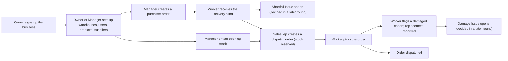

# Scope Document — Mojud core slice

Inputs: the intent statement (`ideation/intent-capture/intent-statement.md`, "intent-statement"), the feasibility assessment (`ideation/feasibility/feasibility-assessment.md`, "feasibility-assessment"), the constraint register (`ideation/feasibility/constraint-register.md`, "constraint-register"), and the answers in `scope-definition-questions.md`.

## Minimum Viable Scope

This round is done when an Owner can sign up a business, staff can sign in, a Manager can set up warehouses, products, suppliers, opening stock and purchase orders, a Warehouse worker can receive a delivery without seeing the ordered amounts, a Sales rep can create a dispatch order, and a Warehouse worker can pick it and flag a damaged carton. The stock record must never go negative, and every change is kept permanently. It all runs on the builder's own machine. (Intent statement S1–S5.)

## In Scope

| # | Capability | Who uses it | Source |
|---|---|---|---|
| 1 | Owner sign-up that creates the business and the Owner's account (scenario 09, first page) | Owner | Intent statement; UX scenario 09 |
| 2 | Sign in and sign out for every user; the Owner or Manager sets each user's password directly | All users | Q1 |
| 3 | All six roles (Owner, Manager, Supervisor, Warehouse worker, Sales rep, Accountant), each with its PRD permissions | All users | Q5 |
| 4 | Setup screens: Warehouses, Users (role, assigned warehouses, password), Products (code, units, carton size, barcode), Suppliers | Owner, Manager | Intent capture Q9 |
| 5 | Opening stock: starting quantity and unit cost per product per warehouse | Manager | Q2 |
| 6 | Purchase orders: a Manager orders products from a supplier for one warehouse | Manager | Intent capture Q9; UX scenario 09 |
| 7 | My tasks: the worker's list of open work (purchase orders to receive, dispatch orders to pick) | Warehouse worker | UX scenario 01 |
| 8 | Blind receiving: the worker counts what arrived without seeing the ordered amounts; a shortfall or over-delivery opens an Issue | Warehouse worker | Intent statement S2; UX scenario 01 |
| 9 | Scan overlay with a typed product code or product search (no camera) | Warehouse worker | Feasibility Q6 |
| 10 | Dispatch orders: a Sales rep orders stock for a customer from one warehouse, which reserves it | Sales rep, Manager, Owner | Intent capture Q9 |
| 11 | Picking: the worker confirms each line as picked, then confirms dispatch | Warehouse worker | Intent statement S3; UX scenario 02 |
| 12 | Flag damage while picking: the carton moves to Damaged, a replacement is reserved automatically, and a damage Issue opens | Warehouse worker | Intent statement S3; UX scenario 02 |
| 13 | Stock record rules: stock never goes negative, and every change is a permanent stock movement | (system) | Intent statement S4 |
| 14 | Runs locally with Docker Compose | Builder | Intent statement S5; constraint register C-T2 |

## Out of Scope (this round)

| Item | Why | Source |
|---|---|---|
| Supervisor decisions on Issues (approve or reject damage, accept shortfalls) | Later round with the Issues inbox (scenario 03); Issues are created now but wait for a decision | Intent capture Q10 |
| Offline queue and sync (scenario 01.4) | Later round | Intent capture Q10 |
| Bangla language | Later round | Intent capture Q10 |
| Excel import (scenario 09.3) | Later round; setup is done on screens instead | Intent capture Q10 |
| Camera barcode scanning | Later round; typed code or search instead | Feasibility Q6 |
| Owner recovery code | Later round | Q3 |
| Segregation of duties (for example, the person who created a purchase order cannot receive it) | Later round | Q3 |
| Stock ladder and movement history screens | Later round | Q3 |
| Stock value and unit-cost updates from receipts | Later round | Q3 |
| Temporary passwords and the shared-phone setting (scenario 10) | Later round | Q1 |
| Scenarios 03–08, 10 and 11 | Later rounds | Initial request |
| Cloud deployment | Not this round | Constraint register C-T2 |

## Value Stream

How value flows through this round, from setup to a dispatched order:

<!-- Text fallback: The Owner signs up the business. The Owner or Manager then sets up warehouses, users, products and suppliers. The Manager enters opening stock and creates a purchase order. A worker receives the delivery without seeing ordered amounts; a shortfall opens an Issue for a later round. A Sales rep creates a dispatch order, which reserves stock from opening stock or received stock. A worker picks the order; if a carton is damaged, they flag it, a replacement is reserved, and a damage Issue opens for a later round. The order is then dispatched. -->

## Glossary

| Term | Meaning |
|---|---|
| Khata | A paper ledger book that many small Bangladeshi businesses use to keep records |
| Purchase order (PO) | A list of products and quantities a business orders from one supplier for one warehouse |
| Blind receiving | Counting a delivery without being able to see how much was ordered, so the count is honest |
| Shortfall | A delivery that arrives with less than was ordered |
| Dispatch order | A request to send products from one warehouse to a customer; it is not an invoice |
| Reserved | Stock held for a dispatch order, so nobody else can promise it |
| Stock movement | One permanent record of a stock change: who, what, when, where, from which state to which state, and why. It is never edited or deleted |
| Issue | An item that needs a person's decision, such as a shortfall or a damaged carton |
| Scan overlay | The screen a worker uses to pick a product by its code; this round it accepts a typed code or a search instead of the camera |
| Scenario 01 / 02 / 09 | Numbered user journeys in the UX design: 01 receive a delivery, 02 pick and flag damage, 09 set up the business |

## Assumptions & Open Questions

- [assumption] Duplicate-submission protection (the PRD's rule that a double tap or retry applies an action only once) is not yet placed in or out of this round; Requirements Analysis should settle it.
- [assumption] Entering quantities in cartons, pieces or both (PRD FR-9) is assumed to be part of the setup and receiving screens, because products have carton and piece units; Requirements Analysis should confirm.
