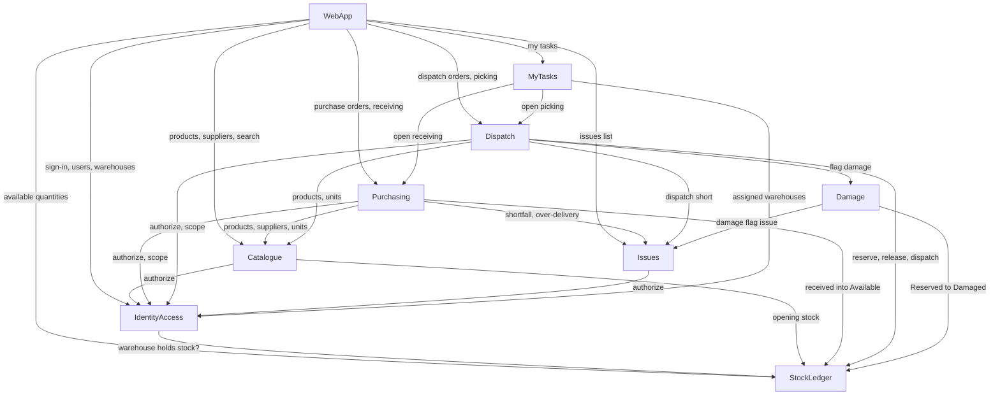

# Components — Mojud core slice

Logical building blocks for this round, derived from `inception/requirements-analysis/requirements.md` (FR1–FR18, NFR1–NFR9), `inception/user-stories/stories.md` (US1.1–US5.3) and the team practices (`team-practices.md`). Deployment topology and technology are decided later (Units Generation, NFR and infrastructure stages). Decisions are recorded in `decisions.md`.

## Component Catalogue

```yaml
components:
  - name: IdentityAccess
    summary: Businesses, warehouses, users, sign-in sessions and the role permission rules
    behaviour: >
      Creates a business with its first Owner at sign-up. Signs users in by phone and password
      (passwords stored only as salted slow hashes; the error never says which field was wrong;
      no lockout this round). Resolves a session into a caller context (business, user, role,
      assigned warehouses) and refuses deactivated users on every request. Enforces the FR2.2
      permission table and warehouse scoping for every other component through an authorize check.
      Manages warehouses (at most 3 active; cannot deactivate one holding stock) and users (Managers
      cannot manage Owners; the last active Owner cannot be deactivated or demoted). Every query is
      scoped to the caller's business.
    responsibilities:
      - Business sign-up and the first Owner
      - Sign-in, sign-out and session validation
      - Users, roles and assigned warehouses
      - Warehouses and the 3-active limit
      - Authorization checks (role table and warehouse scope) for all components
      - Business data isolation rules
    depends_on:
      - component: StockLedger
        interaction: ask whether a warehouse still holds stock before deactivating it
        style: sync
    dependents:
      - component: Catalogue
        interaction: authorize the caller for product, supplier and opening-stock actions
      - component: Purchasing
        interaction: authorize the caller and check warehouse scope
      - component: Dispatch
        interaction: authorize the caller and check warehouse scope
      - component: Issues
        interaction: authorize the caller to view the Issues list
      - component: MyTasks
        interaction: read the worker's assigned warehouses
      - component: WebApp
        interaction: sign up, sign in, sign out, manage users and warehouses
    external_dependencies:
      - name: PostgreSQL
        kind: database
        purpose: store businesses, warehouses, users and sessions
    entities:
      - name: Business
        identifier: businessId
        attributes: [name, createdAt]
      - name: Warehouse
        identifier: warehouseId
        attributes: [businessId, name, active]
      - name: User
        identifier: userId
        attributes: [businessId, name, phone, role, assignedWarehouseIds, passwordHash, active]
      - name: Session
        identifier: sessionId
        attributes: [userId, createdAt, expiresAt]

  - name: Catalogue
    summary: Products, suppliers and the entry of opening stock
    behaviour: >
      Creates and edits products with SKU (unique per business, case-insensitive), base unit,
      optional pack unit and pack size (whole number of 2 or more), and base and pack barcodes
      (a barcode cannot belong to two products). Converts quantities between cartons and pieces
      (stored in base units) for every other component. Searches products by name, SKU or barcode,
      ignoring case. Creates, edits and archives suppliers; archived suppliers cannot be used on
      new purchase orders. Accepts opening stock once per product and warehouse and asks the
      Stock ledger to record it with reason "opening balance".
    responsibilities:
      - Products, units, pack sizes and barcodes
      - Product search
      - Carton and piece conversion
      - Suppliers and archiving
      - Opening stock entry (once per product and warehouse)
    depends_on:
      - component: IdentityAccess
        interaction: authorize Owner or Manager for setup actions
        style: sync
      - component: StockLedger
        interaction: record opening stock as a movement into Available
        style: sync
    dependents:
      - component: Purchasing
        interaction: validate products and suppliers; convert quantities and costs
      - component: Dispatch
        interaction: validate products; convert quantities
      - component: WebApp
        interaction: manage products and suppliers; product search
    external_dependencies:
      - name: PostgreSQL
        kind: database
        purpose: store products and suppliers
    entities:
      - name: Product
        identifier: productId
        attributes: [businessId, name, sku, category, baseUnitName, packUnitName, packSize, baseBarcode, packBarcode]
        references:
          - entity: Business
            owned_by: IdentityAccess
            relationship: each Product belongs to one Business
      - name: Supplier
        identifier: supplierId
        attributes: [businessId, name, contactPerson, phone, address, archived]
        references:
          - entity: Business
            owned_by: IdentityAccess
            relationship: each Supplier belongs to one Business

  - name: StockLedger
    summary: The permanent stock record and the only writer of stock movements
    behaviour: >
      Records every stock change as an append-only movement (business, product, warehouse,
      from-state, to-state, quantity in base units, unit cost, reason, user, server time, source).
      Movements are never edited or deleted; no such operation exists. Keeps balances per product,
      warehouse and state (Available, Reserved, Damaged) equal to the sum of movements. Refuses any
      change that would make a balance negative and returns the maximum allowed. Applies each action
      ID once: a repeated action ID returns the first result without a new movement. Serializes
      concurrent changes to the same product and warehouse so simultaneous requests never
      oversell. Answers available quantities and whether a warehouse holds any stock.
    responsibilities:
      - Append-only stock movements
      - Balances per product, warehouse and state
      - Never-negative rule with the maximum allowed
      - Once-only processing of action IDs
      - Safe concurrent changes
    depends_on: []
    dependents:
      - component: IdentityAccess
        interaction: check whether a warehouse holds stock
      - component: Catalogue
        interaction: record opening stock
      - component: Purchasing
        interaction: record received quantities into Available
      - component: Dispatch
        interaction: reserve, release, dispatch and read Available
      - component: Damage
        interaction: move flagged stock from Reserved to Damaged
      - component: WebApp
        interaction: read Available quantities for the dispatch order form
    external_dependencies:
      - name: PostgreSQL
        kind: database
        purpose: store movements, balances and processed action IDs with transactional locking
    entities:
      - name: StockMovement
        identifier: movementId
        attributes: [businessId, actionId, productId, warehouseId, fromState, toState, quantityBase, unitCost, reason, userId, serverTime, sourceType, sourceId]
        references:
          - entity: Product
            owned_by: Catalogue
            relationship: each movement is for one Product
          - entity: Warehouse
            owned_by: IdentityAccess
            relationship: each movement happens at one Warehouse
          - entity: User
            owned_by: IdentityAccess
            relationship: each movement was made by one User
      - name: StockBalance
        identifier: balanceKey
        attributes: [businessId, productId, warehouseId, state, quantityBase]
        references:
          - entity: Product
            owned_by: Catalogue
            relationship: each balance is for one Product
          - entity: Warehouse
            owned_by: IdentityAccess
            relationship: each balance is at one Warehouse
      - name: ProcessedAction
        identifier: actionId
        attributes: [businessId, result, processedAt]

  - name: Purchasing
    summary: Purchase orders and blind receiving of deliveries
    behaviour: >
      Creates purchase orders for one supplier and one warehouse with lines, expected date and cost
      (stored per base unit). Status is Draft, Sent, Partly received, Received or Cancelled; edits
      and cancellation are allowed only while nothing has been received. Serves receiving screens
      without any ordered or remaining quantity. Saving a counted line asks the Stock ledger to move
      it into Available with reason "received"; a saved line is final. Refuses products not on the
      order. "Mark delivery complete" compares total received with ordered per line, raises Shortfall
      or Over-delivery Issues in the same transaction, and sets Partly received or Received.
    responsibilities:
      - Purchase orders, lines and statuses
      - Edit and cancel before receiving starts
      - Blind receiving (no ordered quantities exposed)
      - Delivery completion and shortfall or over-delivery detection
      - Open receiving work for My tasks
    depends_on:
      - component: IdentityAccess
        interaction: authorize the caller and check warehouse scope
        style: sync
      - component: Catalogue
        interaction: validate supplier and products; convert quantities and costs
        style: sync
      - component: StockLedger
        interaction: record received quantities into Available
        style: sync
      - component: Issues
        interaction: raise Shortfall and Over-delivery Issues in the same transaction
        style: sync
    dependents:
      - component: MyTasks
        interaction: list Sent and Partly received orders in the worker's warehouses
      - component: WebApp
        interaction: manage purchase orders and receive deliveries
    external_dependencies:
      - name: PostgreSQL
        kind: database
        purpose: store purchase orders and receipts
    entities:
      - name: PurchaseOrder
        identifier: purchaseOrderId
        attributes: [businessId, number, supplierId, warehouseId, expectedDate, status, createdBy]
        references:
          - entity: Supplier
            owned_by: Catalogue
            relationship: each PurchaseOrder is from one Supplier
          - entity: Warehouse
            owned_by: IdentityAccess
            relationship: each PurchaseOrder delivers to one Warehouse
      - name: PurchaseOrderLine
        identifier: purchaseOrderLineId
        attributes: [purchaseOrderId, productId, orderedQtyBase, unitCostBase]
        references:
          - entity: Product
            owned_by: Catalogue
            relationship: each line orders one Product
      - name: Receipt
        identifier: receiptId
        attributes: [purchaseOrderId, receivedBy, startedAt, completedAt]
      - name: ReceiptLine
        identifier: receiptLineId
        attributes: [receiptId, productId, countedQtyBase, movementId, actionId]
        references:
          - entity: StockMovement
            owned_by: StockLedger
            relationship: each saved receipt line produced one StockMovement

  - name: Dispatch
    summary: Dispatch orders, reservation, picking and confirming dispatch
    behaviour: >
      Creates dispatch orders for one warehouse with a free-text customer name, lines and a
      needed-by date; saving reserves stock through the Stock ledger, never more than Available.
      Edits raise or lower reservations (never below what is picked); cancelling before dispatch
      releases Reserved stock. Serves picking with each line pre-filled with what is left; confirming
      a line moves it out of Reserved as "dispatched". "Confirm dispatch" sets Dispatched when every
      line is complete, or Part-dispatched when lines are short, with short quantities staying
      Reserved. Flagging damage on a selected line calls Damage, then reserves a replacement for the
      same line; when not enough is Available it marks the line short and raises a Dispatch short
      Issue in the same transaction.
    responsibilities:
      - Dispatch orders, lines and statuses
      - Reservation, edit and cancel with release
      - Picking and dispatch confirmation
      - Replacement reservation after damage and the short-line rule
      - Open picking work for My tasks
    depends_on:
      - component: IdentityAccess
        interaction: authorize the caller and check warehouse scope
        style: sync
      - component: Catalogue
        interaction: validate products; convert quantities
        style: sync
      - component: StockLedger
        interaction: reserve, release, dispatch and read Available
        style: sync
      - component: Damage
        interaction: record a damage flag for a pick line
        style: sync
      - component: Issues
        interaction: raise a Dispatch short Issue in the same transaction
        style: sync
    dependents:
      - component: MyTasks
        interaction: list open dispatch orders in the worker's warehouses
      - component: WebApp
        interaction: manage dispatch orders, pick and flag damage
    external_dependencies:
      - name: PostgreSQL
        kind: database
        purpose: store dispatch orders and lines
    entities:
      - name: DispatchOrder
        identifier: dispatchOrderId
        attributes: [businessId, number, customerName, warehouseId, neededBy, status, createdBy]
        references:
          - entity: Warehouse
            owned_by: IdentityAccess
            relationship: each DispatchOrder ships from one Warehouse
      - name: DispatchOrderLine
        identifier: dispatchOrderLineId
        attributes: [dispatchOrderId, productId, orderedQtyBase, reservedQtyBase, pickedQtyBase, shortQtyBase]
        references:
          - entity: Product
            owned_by: Catalogue
            relationship: each line is for one Product

  - name: Damage
    summary: Damage flags and the move of damaged stock out of sellable stock
    behaviour: >
      Records a damage flag with product, warehouse, quantity, reason (damaged, expired or other),
      optional note, who flagged it and when. This round flags come only from a pick line: the
      quantity cannot exceed what is reserved on that line, and the Stock ledger moves it from
      Reserved to Damaged. Raises a Damage flag Issue in the same transaction. Later rounds add
      flagging from Available and decisions.
    responsibilities:
      - Damage flags and their reasons
      - Reserved-to-Damaged movement
      - Damage flag Issue
    depends_on:
      - component: StockLedger
        interaction: move the flagged quantity from Reserved to Damaged
        style: sync
      - component: Issues
        interaction: raise a Damage flag Issue in the same transaction
        style: sync
    dependents:
      - component: Dispatch
        interaction: flag damage on a selected pick line
    external_dependencies:
      - name: PostgreSQL
        kind: database
        purpose: store damage flags
    entities:
      - name: DamageFlag
        identifier: damageFlagId
        attributes: [businessId, productId, warehouseId, dispatchOrderLineId, quantityBase, reason, note, flaggedBy, flaggedAt, movementId]
        references:
          - entity: DispatchOrderLine
            owned_by: Dispatch
            relationship: each DamageFlag this round comes from one pick line
          - entity: StockMovement
            owned_by: StockLedger
            relationship: each DamageFlag produced one StockMovement

  - name: Issues
    summary: Items that need a person's decision, and their read-only list
    behaviour: >
      Creates Issues of four types this round (Shortfall, Over-delivery, Damage flag, Dispatch
      short) inside the caller's transaction, each with type, product, warehouse, quantity, who
      raised it, when and its source. Lists open Issues newest first for Owner and Manager only.
      No decisions this round.
    responsibilities:
      - Issue creation for four types
      - Read-only Issues list for Owner and Manager
    depends_on:
      - component: IdentityAccess
        interaction: authorize Owner or Manager to view the list
        style: sync
    dependents:
      - component: Purchasing
        interaction: raise Shortfall and Over-delivery Issues
      - component: Dispatch
        interaction: raise Dispatch short Issues
      - component: Damage
        interaction: raise Damage flag Issues
      - component: WebApp
        interaction: show the Issues list
    external_dependencies:
      - name: PostgreSQL
        kind: database
        purpose: store Issues
    entities:
      - name: Issue
        identifier: issueId
        attributes: [businessId, type, productId, warehouseId, quantityBase, raisedBy, raisedAt, sourceType, sourceId, status]
        references:
          - entity: Product
            owned_by: Catalogue
            relationship: each Issue concerns one Product
          - entity: Warehouse
            owned_by: IdentityAccess
            relationship: each Issue is at one Warehouse

  - name: MyTasks
    summary: Read-only list of a worker's open receiving and picking work
    behaviour: >
      Combines Sent and Partly received purchase orders and open dispatch orders in the worker's
      assigned warehouses into one list, dispatch orders ordered by needed-by date, each with a
      New, In progress or Done status. Owns no data.
    responsibilities:
      - Assemble the worker's task list
      - Task status for display
    depends_on:
      - component: IdentityAccess
        interaction: read the worker's assigned warehouses
        style: sync
      - component: Purchasing
        interaction: open receiving work
        style: sync
      - component: Dispatch
        interaction: open picking work
        style: sync
    dependents:
      - component: WebApp
        interaction: show My tasks
    external_dependencies: []
    entities: []

  - name: WebApp
    summary: The browser user interface for all screens in this round
    behaviour: >
      Renders the screens in the refined mockups with our own components built from the design
      system (tokens as CSS variables, light and dark themes, English strings from one translation
      file, desktop from 1024px). Sends a unique action ID with every stock-changing request and
      disables save buttons while saving. Never receives or shows ordered quantities on receiving.
      All rules are enforced again on the server.
    responsibilities:
      - Screens, navigation per role and themes
      - Forms, refusals and confirmations
      - Action IDs on stock-changing requests
    depends_on:
      - component: IdentityAccess
        interaction: sign up, sign in, sign out, manage users and warehouses
        style: sync
      - component: Catalogue
        interaction: manage products and suppliers; product search
        style: sync
      - component: StockLedger
        interaction: read Available quantities for the dispatch order form
        style: sync
      - component: Purchasing
        interaction: manage purchase orders and receive deliveries
        style: sync
      - component: Dispatch
        interaction: manage dispatch orders, pick and flag damage
        style: sync
      - component: Issues
        interaction: show the Issues list
        style: sync
      - component: MyTasks
        interaction: show My tasks
        style: sync
    dependents: []
    external_dependencies: []
    entities: []
```

## Component Diagram



<!-- Text fallback: WebApp calls every component. IdentityAccess asks StockLedger whether a warehouse holds stock. Catalogue uses IdentityAccess for authorization and StockLedger for opening stock. Purchasing uses IdentityAccess, Catalogue, StockLedger and Issues. Dispatch uses IdentityAccess, Catalogue, StockLedger, Damage and Issues. Damage uses StockLedger and Issues. Issues uses IdentityAccess. MyTasks uses IdentityAccess, Purchasing and Dispatch. StockLedger calls nothing. There are no cycles. -->

## Component Summary

| Component | Purpose | Depends On | Dependents | Entities Owned |
|---|---|---|---|---|
| IdentityAccess | Businesses, warehouses, users, sessions, permissions | StockLedger | Catalogue, Purchasing, Dispatch, Issues, MyTasks, WebApp | Business, Warehouse, User, Session |
| Catalogue | Products, suppliers, unit conversion, opening stock | IdentityAccess, StockLedger | Purchasing, Dispatch, WebApp | Product, Supplier |
| StockLedger | Permanent stock record; only writer of movements | — | IdentityAccess, Catalogue, Purchasing, Dispatch, Damage, WebApp | StockMovement, StockBalance, ProcessedAction |
| Purchasing | Purchase orders and blind receiving | IdentityAccess, Catalogue, StockLedger, Issues | MyTasks, WebApp | PurchaseOrder, PurchaseOrderLine, Receipt, ReceiptLine |
| Dispatch | Dispatch orders, reservation, picking | IdentityAccess, Catalogue, StockLedger, Damage, Issues | MyTasks, WebApp | DispatchOrder, DispatchOrderLine |
| Damage | Damage flags | StockLedger, Issues | Dispatch | DamageFlag |
| Issues | Issue creation and read-only list | IdentityAccess | Purchasing, Dispatch, Damage, WebApp | Issue |
| MyTasks | Worker's task list (read-only) | IdentityAccess, Purchasing, Dispatch | WebApp | — |
| WebApp | Browser user interface | all of the above except Damage | — | — |

## Entity Ownership

| Entity | Owning Component | Identifier | Attributes | References |
|---|---|---|---|---|
| Business | IdentityAccess | businessId | name, createdAt | — |
| Warehouse | IdentityAccess | warehouseId | businessId, name, active | — |
| User | IdentityAccess | userId | businessId, name, phone, role, assignedWarehouseIds, passwordHash, active | — |
| Session | IdentityAccess | sessionId | userId, createdAt, expiresAt | — |
| Product | Catalogue | productId | businessId, name, sku, category, baseUnitName, packUnitName, packSize, baseBarcode, packBarcode | Business |
| Supplier | Catalogue | supplierId | businessId, name, contactPerson, phone, address, archived | Business |
| StockMovement | StockLedger | movementId | businessId, actionId, productId, warehouseId, fromState, toState, quantityBase, unitCost, reason, userId, serverTime, sourceType, sourceId | Product, Warehouse, User |
| StockBalance | StockLedger | balanceKey | businessId, productId, warehouseId, state, quantityBase | Product, Warehouse |
| ProcessedAction | StockLedger | actionId | businessId, result, processedAt | — |
| PurchaseOrder | Purchasing | purchaseOrderId | businessId, number, supplierId, warehouseId, expectedDate, status, createdBy | Supplier, Warehouse |
| PurchaseOrderLine | Purchasing | purchaseOrderLineId | purchaseOrderId, productId, orderedQtyBase, unitCostBase | Product |
| Receipt | Purchasing | receiptId | purchaseOrderId, receivedBy, startedAt, completedAt | — |
| ReceiptLine | Purchasing | receiptLineId | receiptId, productId, countedQtyBase, movementId, actionId | StockMovement |
| DispatchOrder | Dispatch | dispatchOrderId | businessId, number, customerName, warehouseId, neededBy, status, createdBy | Warehouse |
| DispatchOrderLine | Dispatch | dispatchOrderLineId | dispatchOrderId, productId, orderedQtyBase, reservedQtyBase, pickedQtyBase, shortQtyBase | Product |
| DamageFlag | Damage | damageFlagId | businessId, productId, warehouseId, dispatchOrderLineId, quantityBase, reason, note, flaggedBy, flaggedAt, movementId | DispatchOrderLine, StockMovement |
| Issue | Issues | issueId | businessId, type, productId, warehouseId, quantityBase, raisedBy, raisedAt, sourceType, sourceId, status | Product, Warehouse |

## External Dependencies

| Component | Dependency | Kind | Purpose |
|---|---|---|---|
| IdentityAccess | PostgreSQL | database | Businesses, warehouses, users, sessions |
| Catalogue | PostgreSQL | database | Products and suppliers |
| StockLedger | PostgreSQL | database | Movements, balances, processed actions, with transactional locking |
| Purchasing | PostgreSQL | database | Purchase orders and receipts |
| Dispatch | PostgreSQL | database | Dispatch orders and lines |
| Damage | PostgreSQL | database | Damage flags |
| Issues | PostgreSQL | database | Issues |

## Rationale

| Component | Why it is a separate block |
|---|---|
| IdentityAccess | Distinct concern (who may do what, where); every other block depends on its rules; owns the organisation structure (business, warehouses) that scopes access (ADR-006) |
| Catalogue | Distinct data (products, suppliers) with its own lifecycle and a slower change rate than orders |
| StockLedger | The correctness core: one owner for never-negative, append-only and once-only rules (ADR-002) |
| Purchasing | Distinct lifecycle (Draft → Sent → Partly received → Received) and the blind-receiving rule |
| Dispatch | Distinct lifecycle (Open → Part-dispatched → Dispatched) and reservation rules |
| Damage | Distinct concern that grows in later rounds (flag from stock, decisions) (ADR-004) |
| Issues | Shared by three blocks; grows into the Issues inbox and decisions later |
| MyTasks | Read-only composition across two blocks, no data of its own (ADR-005) |
| WebApp | The user interface; holds no business rules that the server does not also enforce |

**Alternatives Rejected:** four larger blocks (Identity, Setup, Stock, Orders) and one block per screen; see ADR-001. Warehouses in Catalogue was rejected to avoid a dependency cycle; see ADR-006.

## Assumptions & Open Questions

- [assumption] Warehouses are owned by IdentityAccess rather than Catalogue (the Q1 option listed them under Catalogue). This avoids a call cycle between the two blocks, because access rules are scoped by warehouse; see ADR-006.
