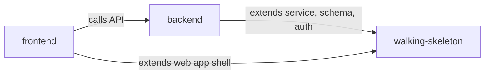

# Unit Dependencies — Mojud core slice

Topology between the units in `unit-of-work.md`, derived from the component dependencies in `inception/domain-design/components.md` and covering `requirements.md` and `stories.md`. This file describes what depends on what; the build sequence is chosen in Delivery Planning.

## Dependency Graph

```yaml
units:
  - name: walking-skeleton
    depends_on: []
  - name: backend
    kind: service
    depends_on: [walking-skeleton]
  - name: frontend
    kind: ui
    depends_on: [backend, walking-skeleton]
```



<!-- Text fallback: backend depends on walking-skeleton. frontend depends on backend and on walking-skeleton. walking-skeleton depends on nothing. There are no cycles. -->

## Edges

| Unit | Depends on | Why |
|---|---|---|
| U2 backend | U1 walking-skeleton | Adds modules to U1's backend service, migrations to its database, and builds on its sign-in, sessions and caller context |
| U3 frontend | U2 backend | Every remaining screen calls U2's API |
| U3 frontend | U1 walking-skeleton | Adds screens to U1's app shell, theme and translation file |

## Integration Points

| Between | Mechanism | What crosses |
|---|---|---|
| U1 web app ↔ U1 backend | HTTP JSON API | Sign-up, sign-in, sign-out, session cookie |
| U2 modules ↔ U1 IdentityAccess | In-process function calls | Caller context (business, user, role, warehouses); authorization checks |
| U2 modules ↔ each other | In-process function calls inside one database transaction | Stock movements, Issues, damage flags (ADR-002, ADR-003, ADR-007) |
| U3 ↔ U2 | HTTP JSON API | Settings, orders, receiving, picking, damage, Issues, My tasks; action IDs on stock changes |
| All ↔ PostgreSQL | Shared database, one schema per module's tables | Data owned per the component catalogue |

The API contracts between U3 and U2 (and U1's endpoints) are defined in Contract Design.

## Walking Skeleton

U1 is first in every valid order: it depends on nothing and everything depends on it. It runs on its own: Docker Compose starts the web app, backend and database; a person signs up a business in the browser, the backend writes the Business and Owner to PostgreSQL, and signing in again reads them back. This exercises every integration path the later units use (browser → API → module → database, sessions, migrations).

## Parallel Development Opportunities

None with this split: U1 → U2 → U3 is the only valid order, because U3 depends on U2 and U2 on U1 (Q4 allows parallel work, but no two units are independent).

## Assumptions & Open Questions

None.
