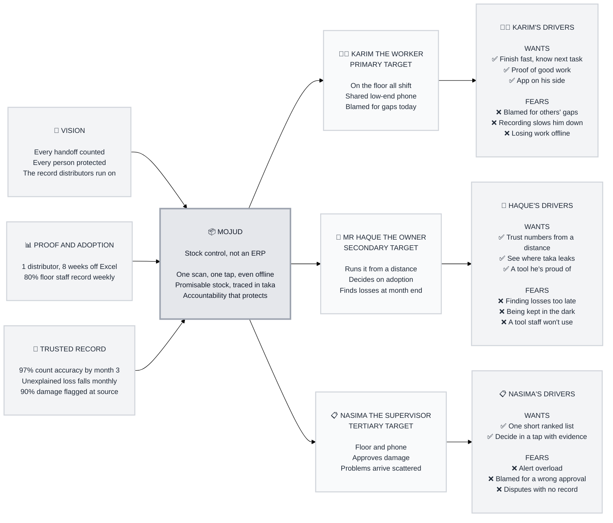

# Trigger Map Poster: Mojud (E2E_IAM)

> Visual overview connecting business goals to user psychology

**Created:** 2026-10-23
**Author:** eshtiakhasan
**Methodology:** Based on Effect Mapping (Balic & Domingues), adapted for the WDS framework
**Path:** Built from existing documentation as a light pass (Product Brief, PRD §1, §2 and §8, EXPERIENCE.md UJ-1 … UJ-9)

---

## Strategic Documents

- [../A-Product-Brief/project-brief.md](../A-Product-Brief/project-brief.md): strategic foundation
- [personas/02-Karim-the-Warehouse-Worker.md](personas/02-Karim-the-Warehouse-Worker.md): primary persona
- [personas/03-Haque-the-Owner.md](personas/03-Haque-the-Owner.md): secondary persona
- [personas/04-Nasima-the-Supervisor.md](personas/04-Nasima-the-Supervisor.md): tertiary persona
- [feature-impact-analysis.md](feature-impact-analysis.md): v1 features scored against the personas

---

## Vision

**"Every handoff counted. Every person protected."**

Mojud becomes the trusted record that small Bangladeshi FMCG distributors run
their warehouses on. Recording is quicker than not recording, and the same
record that holds people accountable also protects honest workers.

---

## Business Objectives

All targets are `[ASSUMPTION]` until validated with real distributors (PRD §8).

### Objective 1: Product proof (SM-7)
- **Metric:** consecutive weeks a real distributor runs on Mojud instead of Excel or khata
- **Target:** 8 consecutive weeks
- **Timeline:** first pilot after the core increments ship

### Objective 2: Floor adoption (SM-2)
- **Metric:** share of Warehouse workers and Sales reps with at least one recorded action per working week
- **Target:** ≥ 80%
- **Timeline:** sustained across the pilot

### Objective 3: Record accuracy (SM-1)
- **Metric:** share of Stock count lines where counted = On hand
- **Target:** ≥ 97%
- **Timeline:** by month 3 (baseline = first full count)

### Objective 4: Losses get explained (SM-4)
- **Metric:** Unexplained value in taka; share of Discrepancy cases resolved within 7 days
- **Target:** falls month on month; ≥ 80% resolved within 7 days
- **Timeline:** monthly, from month 2

### Objective 5: Damage captured at source (SM-5)
- **Metric:** share of damage losses that come from Damage flags (not counts); time to decide a flag
- **Target:** ≥ 90%; decided within 24 h
- **Timeline:** monthly

**Guardrails (counter-metrics, do not optimise):** don't count less often to raise
accuracy (SM-C1), don't close cases as "unknown" to look fast (SM-C2), don't
discourage damage reporting (SM-C3).

**How the objectives connect:** workers adopt (2) → records get complete and
accurate (3, 5) → the owner sees explained losses (4) → the distributor keeps
using it (1). Floor adoption drives everything else.

---

## Target Groups (Prioritized)

### 1. Karim the Warehouse Worker (PRIMARY)

**Priority reasoning:** every objective depends on the floor recording. If
workers skip recording, accuracy, damage capture and loss tracing all fail, and
the pilot fails with them. Impact: High. Feasibility: High (they are on site
every day, and the effort budget is designable).

> Stands all shift, often one-handed, on a shared low-end Android phone, in dim
> or bright warehouses with patchy signal. Is the person blamed today when stock
> goes missing.

**Key positive drivers:**
- Finish the task fast and know what to do next
- Have proof of good work ("My record")
- Feel that the app is on their side

**Key negative drivers:**
- Being blamed for gaps they didn't cause
- Recording that slows them down or adds steps
- Losing work when the network drops
- Looking foolish on an English-only or confusing screen

### 2. Mr. Haque the Owner (SECONDARY)

**Priority reasoning:** decides whether the business adopts and keeps using
Mojud (objective 1), and is the audience for explained losses (objective 4).
Impact: High. Feasibility: Medium (not on the floor and time-poor; trust has to
be earned).

> Runs the business from home or the office, checks in by phone, and cannot
> visit the warehouses every day. Learns about losses at month end as a number
> nobody can explain.

**Key positive drivers:**
- Trust the numbers without visiting the warehouse
- See where taka is leaking, and act on it
- Hand staff a tool he's proud of

**Key negative drivers:**
- Finding losses too late to do anything
- Being lied to or kept in the dark by staff
- Paying (in time or money) for a tool staff won't use
- His data being lost or exposed

### 3. Nasima the Supervisor (TERTIARY)

**Priority reasoning:** closes the loop. Damage flags, shortfalls and transfer
differences all land on her (objective 5's 24 h target, and objective 4).
Impact: Medium-High. Feasibility: High.

> On the floor and on her phone, answerable to both the workers and the manager.
> Today she gets problems verbally, scattered across WhatsApp.

**Key positive drivers:**
- One short, ranked list of problems
- Decide each in a tap, with the evidence in front of her
- Clear the inbox before shift end

**Key negative drivers:**
- Alert overload and endless notifications
- Approving something wrong and being blamed for it
- Disputes between workers with no record to settle them

### Supporting groups (not deep personas)

| Group | Wants (+) | Fears (−) | Main surfaces |
|---|---|---|---|
| **Sales rep (Tanvir)** | Promise confidently while the customer waits (≤ 10 s) | Over-promising and losing face | Product search, promisable stock, Dispatch orders |
| **Manager** | Know what's promisable; fix discrepancies with evidence | Discrepancies with no trail; counts nobody trusts | Stock counts, Discrepancy cases, POs, Transfers |
| **Accountant** | Stock value traceable to movements | Figures that can't be defended | Stock value, movement history |

---

## Trigger Map Visualization

**Text fallback:** Vision, proof/adoption goals and trusted-record goals feed into
Mojud. Mojud serves Karim (primary), Mr. Haque (secondary) and Nasima
(tertiary), each with the wants and fears listed above.

---

## Design Focus Statement

**Design every floor moment so that recording is the quickest path *and* Karim's
protection.** Speed (one scan, one tap, offline-safe) and proof ("saved", "My
record") are what turn floor adoption into a record Mr. Haque can trust. Nasima's
inbox is what keeps that record clean.

**Primary Design Target:** Karim the Warehouse Worker

**Must address:**
- Fear of blame → every action gives immediate visible proof (who, when, saved)
- Fear of slowness → ≤ 1 scan + 1 tap with defaults; next task shown straight away
- Fear of losing work offline → "Saved on phone, will sync", never an error
- Owner's fear of finding losses late → losses in taka, drillable to evidence
- Supervisor's alert overload → one ranked inbox, decide in a tap

**Should address:**
- Owner's pride in the tool → calm, professional visual quality (DESIGN.md)
- Supervisor's fear of a wrong approval → evidence on the card before deciding
- Bilingual comfort → Bangla first-class on floor screens

---

## Cross-Group Patterns

### Shared drivers
- **Fear of blame without evidence** (worker, supervisor, owner from the other
  side). The same evidence trail satisfies all three, which is Mojud's core bet.
- **Time poverty.** Everyone wants fewer steps: the worker per action, the
  supervisor per issue, the owner per glance.

### Unique drivers
- Worker: offline safety and shared-phone identity
- Owner: seeing in taka, from a distance
- Supervisor: ranking and closure ("inbox zero" at shift end)

### Potential tensions
- **Accountability vs protection:** the owner wants to know *who*; the worker
  fears being singled out. Resolution: show evidence and cases, never people
  scores (brief: the "Trust Score" idea was rejected).
- **Controls vs speed:** blind receiving and counts add effort for the worker.
  This is accepted as the recorded exception to the effort budget
  (EXPERIENCE.md → Interaction Primitives → Budget).

---

## Gap Analysis

| Area | Status | Handling |
|---|---|---|
| Vision and objectives | Strong (PRD §1, §8, measurable) | Used as-is |
| Target groups and JTBD | Strong (PRD §2.1, 9 journeys) | Used as-is |
| Negative drivers / fears | **Inferred**, not from research | Noted for later: validate in 3–5 distributor interviews |
| Real user quotes | **Missing** | Noted for later: personas carry illustrative quotes only |
| Shared-phone sign-in behaviour | Open (PRD §9 Q2) | Carry into Phase 3/4 as a design assumption |

**Alignment check:** good. The objectives serve the vision, the primary group
drives the objectives, and the v1 features address the top drivers (see
feature-impact-analysis.md).

---

## Next Steps

- [ ] Phase 3: UX Scenarios. Build scenarios around Karim first, then Mr. Haque and Nasima
- [ ] Use the Design Focus Statement as a review check in Phase 4
- [ ] Validate inferred fears in distributor interviews and update this map

---

_Generated with Whiteport Design Studio framework_
_Trigger Mapping methodology credits: Effect Mapping by Mijo Balic & Ingrid Domingues (inUse), adapted with negative driving forces_
